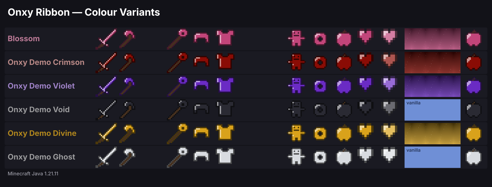

# OnxyMc Texture Pack Showcase

A Windows desktop app to import, organise, preview, animate, showcase and install Minecraft Java Edition resource packs. It targets **1.21.11** (resource-pack format 75) and reads older formats too.

Built with **Tauri 2 + React + TypeScript**. Rust handles file operations and installation; Canvas renders the showcases and animations; three.js handles 3D models.



## Building the Windows `.exe`

The Windows executable has to be compiled on Windows. There are two ways to do it.

**Option A: GitHub Actions (no setup on your PC).** Push this folder to a GitHub repository. Open **Actions → Windows build → Run workflow**. When the run finishes, download the `OnxyMc-Showcase-Windows` artifact. It contains:
- `OnxyMc Texture Pack Showcase_1.0.0_x64-setup.exe`: the NSIS installer (per-user, no admin needed)
- `…_x64_en-US.msi`: the MSI installer
- `OnxyMc-Showcase-portable.zip`: a single portable `.exe`

**Option B: build on your own PC.** First install these, one time:
1. [Node.js 20+](https://nodejs.org)
2. [Rust](https://rustup.rs), using the default MSVC toolchain
3. Visual Studio Build Tools with the **Desktop development with C++** workload

Then, in PowerShell inside this folder, run:
```powershell
./build-windows.ps1
```
The installers and the portable `.exe` end up in `dist-windows\`.

**About the portable build:** it's the bare `onxymc-showcase.exe`. It uses the WebView2 runtime that ships with Windows 10 and 11. Settings and the library are stored in `%APPDATA%\com.onxymc.showcase\store`.

**Running in development:** use `npm install`, then `npm run tauri dev`. Running `npm run dev` alone opens a browser preview. That preview can import and showcase packs (it stores them in IndexedDB), but it can't install packs into Minecraft.

## Features

| Area | What it does |
|---|---|
| **Dashboard** | Shows stats, featured, favourite, recently viewed and recently added packs, plus search and category filters. Each pack card has Favourite, View Showcase, Install and Download buttons. Download only appears when the pack has a URL. |
| **Library** | Imports multiple ZIPs or pack folders, including by drag & drop. Grid and list views are virtualised. You can rename, describe, categorise, tag, set thumbnails and drag to reorder. Refresh re-reads a pack from its source. Metadata can be exported and imported as JSON. Removing a pack never deletes its file. |
| **Showcase Creator** | Includes 8 templates and lets you save your own. Variant rows can each use a different pack, with a name, hex colour, badge and visibility toggle. Rows and item columns can be dragged to reorder. The item picker covers 100+ catalog items (netherite/diamond gear, spears, mace, totem, pearl, golden apples, end crystal, respawn anchor, shield, elytra, hearts, particles…). You can also add any texture file from a pack, and override the texture of a single cell. Style controls cover backgrounds, fonts (including OFL pixel fonts), sizes, spacing, borders, corner radius, glow, stripes, swatches, hex labels, version/description footer, sky column, animation speed and zoom. Undo/redo (Ctrl+Z / Ctrl+Y), reset and duplicate are included. Everything autosaves and can be saved as a `.onxyshowcase` project. |
| **Texture resolution** | Follows 1.21.4+ item definitions (`assets/*/items/*.json`, including `select`, `condition`, `range_dispatch` and `composite`) to item models and their parent chains. Falls back to the standard texture paths. Applies `pack.mcmeta` overlays that are active for format 75. Packs zipped inside an extra top folder are detected. |
| **Animations** | Reads `.png.mcmeta` the way vanilla does: 50 ms ticks, `frametime`, custom `frames` with per-frame `time`, `width`/`height`, and per-tick `interpolate`. Playback has play/pause/restart, frame stepping, speed, loop, pixel-perfect zoom and a frame strip. One shared clock drives every animation. It only wakes when a frame changes (at most 20/s) and pauses animations that are off-screen or in a hidden window. |
| **3D preview** | Renders element models with parent chains, texture aliases (`#ref`), face UVs and rotations, and element rotations including `rescale`. Flat items are extruded 1 px deep like in-game. Lighting can be Minecraft face shading, studio or flat. Also offers inventory view (uses the model's `display.gui`), auto-rotate, background colour and camera reset. Animated textures animate in 3D too. A player model shows 1.21.4+ `entity/equipment/humanoid(_leggings)` armor, or the legacy `models/armor/*_layer_N.png`. |
| **Skybox (Skyboxify)** | Parses `optifine/sky/worldN/skyN.properties` (and `mcpatcher/sky`), ported from [Skyboxify's source](https://github.com/legacy-visuals-project/Skyboxify). That includes the 3×2 face layout, the hh:mm→tick conversion, fade in/out maths, all 9 blend equations, axis/speed rotation and `source` path rules. The preview has a draggable camera, a 360° panorama, a time slider with sunrise/day/sunset/night presets, time-lapse, rain and per-layer toggles. Sky strips also appear inside showcases. |
| **Install** | Auto-detects `%APPDATA%\.minecraft\resourcepacks`, or you can pick any launcher instance folder. Shows copy progress, then verifies the result. If a pack already exists, nothing changes until you choose Overwrite or Back up & replace. Removing a pack asks for confirmation and only works on copies this app installed. Copies go to a temporary name and are then renamed, so a failed copy never leaves a broken pack. |
| **Export** | PNG (1–6× scale), 1080p, 1440p, 4K, a YouTube thumbnail size, a Discord size and custom sizes; transparent PNG; GIF; MP4 (H.264 via WebCodecs, with WebM fallback); and the editable project file. Every export re-renders the showcase at the target size through the same renderer as the editor. Nothing is a screenshot that's been scaled up. Animated exports use real tick timing, and identical GIF frames are merged. |
| **Appearance** | Themes: Onxy Red, Blossom Pink, Violet, Ghost, Christmas (with snow), Midnight and Custom. The custom editor covers 13 colours plus radius, transparency, glow and animation intensity. Light sweep, background particles, reduce-motion and a pixel UI font are optional. |
| **Settings** | Paths, animation, performance (FPS cap, offscreen pause, texture-cache budget and clear), rotating automatic showcase backups with restore, and an About page. |

## Security and data safety

- ZIPs are **never extracted to disk**. Entries are read in memory with path sanitising: `..`, absolute paths and drive letters are rejected. There are caps on entry count, entry size (64 MB) and compression ratio, which blocks zip bombs.
- PNGs are signature- and dimension-checked before decoding. JSON and `.properties` files are parsed defensively.
- Nothing inside a pack is ever executed. Only `https://` links can be opened.
- Folder reads never follow symlinks and can't escape the pack root.
- Library, settings and showcases are written atomically (temp file → fsync → rename) with a `.bak`. If a file is corrupted, the app falls back to the backup.

## Testing

```
node scripts/make-test-packs.mjs test-packs   # demo packs (original procedural art)
npm test                                      # 19 unit tests for core parsers
cd src-tauri && cargo test                    # 5 Rust tests, including install/remove through real Tauri IPC
npm run build && npx vite preview & node tests/e2e.mjs   # 19-step browser E2E in Chrome
```
The demo packs include colour variants, an interpolated animation with a custom frame order, a 1.21.4+ item definition, a two-layer Skyboxify sky, armor layers, a pack nested inside an extra folder, and a deliberately malicious ZIP (path traversal plus a `.bat` file).

## Known limitations

- **Skyboxify:** the sun, moon, stars and fog colour are not drawn. `biomes`, `heights` and `days` conditions are shown as text but not simulated: every layer is previewed as if its conditions are met. The base sky colour approximates plains.
- **Models:** items drawn by built-in entity renderers (shield, trident, chests, banners) can't be rendered accurately in 3D. For those, the app clearly shows the 2D texture instead. OptiFine CIT is detected but not applied.
- **Vanilla textures:** none are bundled, because they are Mojang assets. If a pack doesn't override an item, that cell stays empty. You can set a *fallback pack* per showcase, for example the vanilla resources you extract yourself.
- **Video:** MP4 depends on the H.264 encoder in WebView2. It's present on standard Windows 10/11 builds. If it isn't, the app offers WebM, and the GIF export always works.
- **Code signing:** the installer is unsigned, so Windows SmartScreen will warn the first time it runs.
- **Updates:** there is no update server. The "check for updates" preference makes no network calls.

Minecraft is a trademark of Mojang AB. This project is not affiliated with Mojang or Microsoft.
